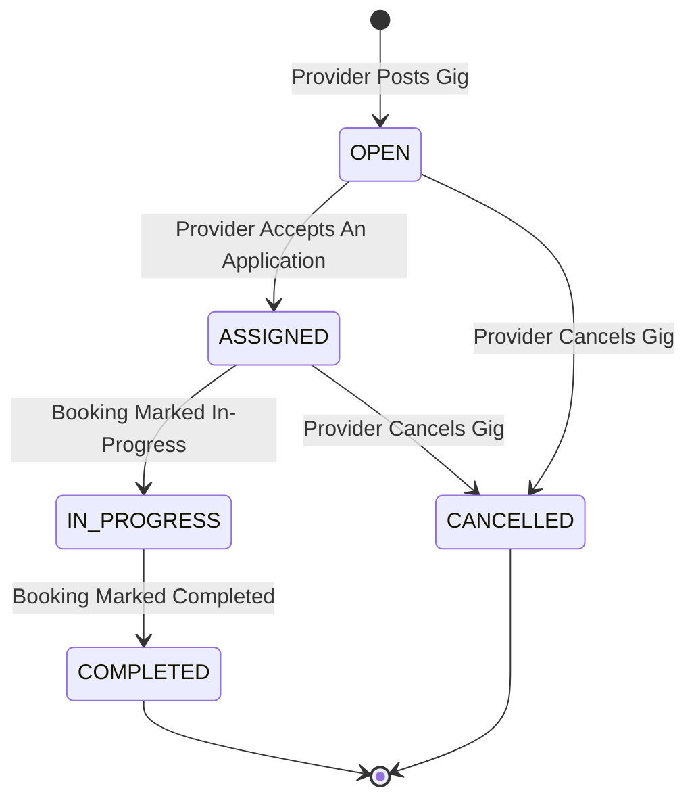
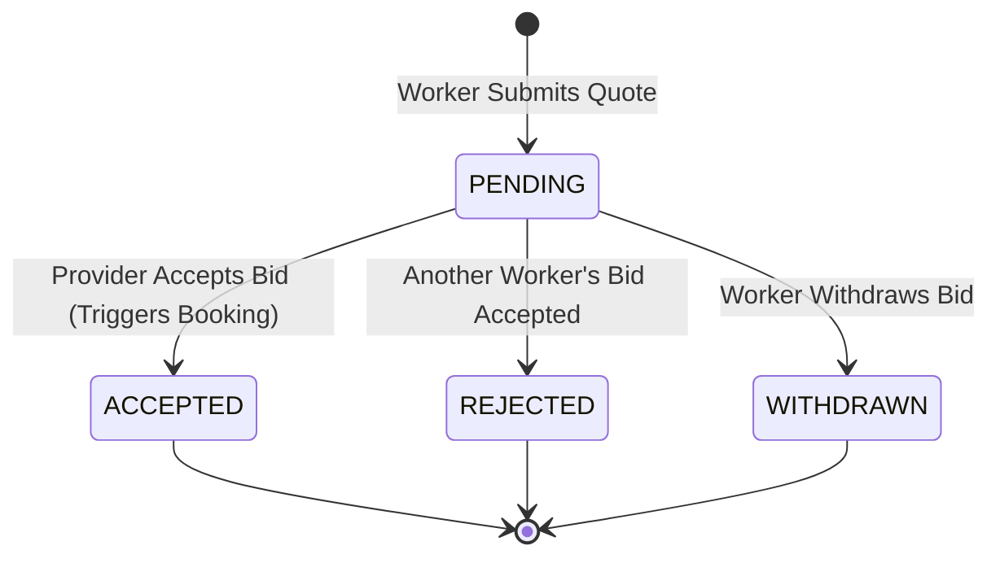
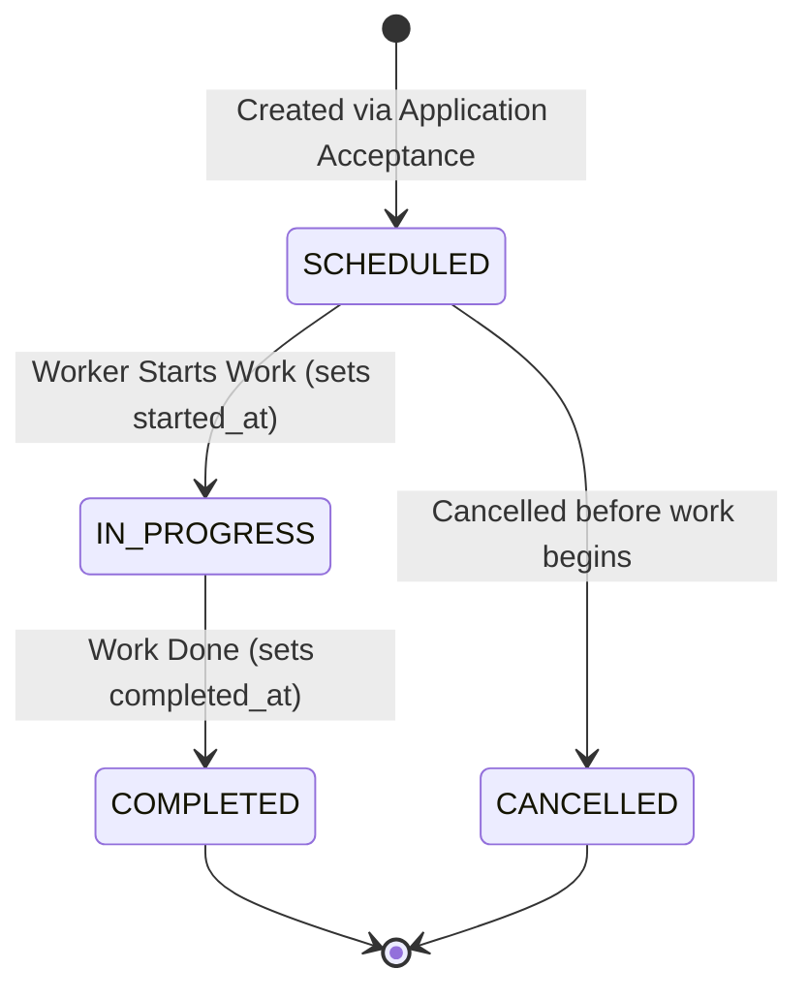

# GigMart Architecture & System Design Document

This document provides a comprehensive architectural blueprint of the GigMart backend platform. It outlines domain models, lifecycle state machines, transaction boundaries, calculation formulas, and persistence invariants.

---

## 1. High-Level Architectural Pattern

The application follows a standard **Layered Architecture** with strict separation of concerns and Domain-Driven Design (DDD) principles:

```mermaid
graph TD
    Client[REST Clients / Frontend / Mobile Apps] --> ControllerLayer[Controller Layer (@RestController)]
    ControllerLayer --> ServiceLayer[Service Layer (@Service, @Transactional)]
    ServiceLayer --> RepositoryLayer[Repository Layer (Spring Data JPA)]
    RepositoryLayer --> Database[(MySQL Database)]
    ServiceLayer -.-> DTOs[DTO & ApiResponse Layer]
    ServiceLayer -.-> Entities[JPA Entities & Enums]
```

### Layer Responsibilities
1. **Controller Layer (`com.gigsphere.gigmart.controller`)**:
   - HTTP routing under `/api/v1/*`.
   - Request payload validation (`@Valid`).
   - Standardized JSON responses encapsulated in `ApiResponse<T>`.
   - Never exposes JPA entities directly; always operates on DTOs.
2. **Service Layer (`com.gigsphere.gigmart.service`)**:
   - Encapsulates all domain and business rules.
   - Manages database transaction boundaries (`@Transactional`).
   - Enforces state transitions, invariants, and calculations.
3. **Repository Layer (`com.gigsphere.gigmart.repository`)**:
   - Spring Data JPA interfaces extending `JpaRepository<T, UUID>`.
   - Custom JPQL queries with parameter binding for filtering, search, and dynamic aggregation.
4. **Entity Layer (`com.gigsphere.gigmart.entity`)**:
   - 14 JPA entities mapped to MySQL tables.
   - Enforces database-level foreign keys, unique constraints, and indexes.

---

## 2. Domain Entities & Cardinalities

The domain model faithfully mirrors `gig_platform_erd.md`:

| Entity | Primary Key | Foreign Keys / Associations | Cardinality | Key Attributes & Invariants |
|---|---|---|---|---|
| `User` | UUID | None | Root | `email` (unique), `phone` (unique), `role` (`WORKER`, `PROVIDER`, `ADMIN`), `passwordHash` |
| `WorkerProfile` | UUID | `user_id` -> `User` | 1 : 0..1 | One-to-One with User. `avgRating` (0.0 to 5.0), `serviceRadiusKm`, `verificationStatus` |
| `ProviderProfile` | UUID | `user_id` -> `User` | 1 : 0..1 | One-to-One with User. `providerType` (`INDIVIDUAL`, `BUSINESS`), `avgRating` |
| `Address` | UUID | `user_id` -> `User` | 1 : Many | Physical job location with GPS coordinates (`latitude`, `longitude`). |
| `ServiceCategory` | UUID | None | Master | `name` (unique), `icon`, `isActive`. |
| `WorkerService` | UUID | `worker_id`, `category_id` | Join | Unique constraint `(worker_id, category_id)`. `baseRate`, `rateType` (`HOURLY`, `FIXED`). |
| `WorkerDocument` | UUID | `worker_id` -> `WorkerProfile` | 1 : Many | `docType`, `fileUrl`, `status` (`PENDING`, `APPROVED`, `REJECTED`). |
| `AvailabilitySlot` | UUID | `worker_id` -> `WorkerProfile` | 1 : Many | `dayOfWeek` (1=Mon to 7=Sun), `startTime`, `endTime`. |
| `Gig` | UUID | `provider_id`, `category_id`, `address_id` | 1 : Many | Posted job. `budget`, `scheduledAt`, `status`. Indexes on `(category_id, status)` and `(scheduled_at)`. |
| `Application` | UUID | `gig_id` -> `Gig`, `worker_id` -> `WorkerProfile` | 1 : Many | Unique constraint `(gig_id, worker_id)`. `quotedPrice`, `coverNote`, `status`. |
| `Booking` | UUID | `gig_id` -> `Gig`, `application_id` -> `Application` | 1 : 0..1 | Unique constraint on `gig_id` and `application_id`. `agreedPrice`, `startedAt`, `completedAt`, `status`. |
| `Payment` | UUID | `booking_id` -> `Booking` | 1 : Many | `amount`, `platformFee`, `method`, `status` (`PENDING`, `PAID`, etc.), `paidAt`. |
| `Review` | UUID | `booking_id`, `reviewer_id`, `reviewee_id` | 1 : 2 per booking | Unique constraint `(booking_id, reviewer_id)`. `rating` (1-5), `comment`. |
| `Message` | UUID | `gig_id`, `sender_id`, `receiver_id` | 1 : Many | In-gig communication chat thread. Scoped to gig. |

---

## 3. Lifecycle State Machines

### 3.1 Gig Lifecycle



### 3.2 Application Lifecycle



### 3.3 Booking Lifecycle



---

## 4. Business Logic Invariants & Formulas

### 4.1 Atomic Application Acceptance
When a provider accepts application $A_1$ for gig $G$:
1. $A_1.status \leftarrow \text{ACCEPTED}$
2. $G.status \leftarrow \text{ASSIGNED}$
3. For all other applications $A_k \in G.applications$ where $A_k \neq A_1$ and $A_k.status = \text{PENDING}$:
   $$A_k.status \leftarrow \text{REJECTED}$$
4. A new `Booking` is created with:
   - $Booking.agreedPrice = A_1.quotedPrice$
   - $Booking.status = \text{SCHEDULED}$

### 4.2 Platform Fee Calculation
Platform fee is configured at **10%** of the transaction amount:
$$\text{platformFee} = \text{round}(\text{amount} \times 0.10, 2)$$
$$\text{netWorkerAmount} = \text{amount} - \text{platformFee}$$

### 4.3 Dynamic Rating Aggregation
Upon review submission ($R$ rating $\in [1, 5]$):
1. Reviewer must be a verified participant of the booking (either provider user or worker user).
2. Reviewee is determined as the opposite participant.
3. Database checks constraint `uk_booking_reviewer` to prohibit duplicate reviews.
4. Review is persisted.
5. Reviewee's average rating is recalculated dynamically:
   $$\overline{\text{Rating}} = \frac{1}{N} \sum_{i=1}^{N} \text{rating}_i$$
6. Rounded to 2 decimal places and written directly to `WorkerProfile.avgRating` or `ProviderProfile.avgRating`.

---

## 5. Security & Authentication Strategy

- **Password Storage**: Passwords are cryptographically hashed using **SHA-256** with hexadecimal encoding before being stored in `users.password_hash`.
- **Sensitive Data Exclusion**: `@JsonIgnore` is applied on `passwordHash` to ensure credentials never leak in serialization.
- **DTO Isolation**: All API contracts communicate through discrete Request and Response DTOs.
- **CORS Protection**: Configured in `WebMvcConfig` to permit Cross-Origin Resource Sharing with frontend clients.
