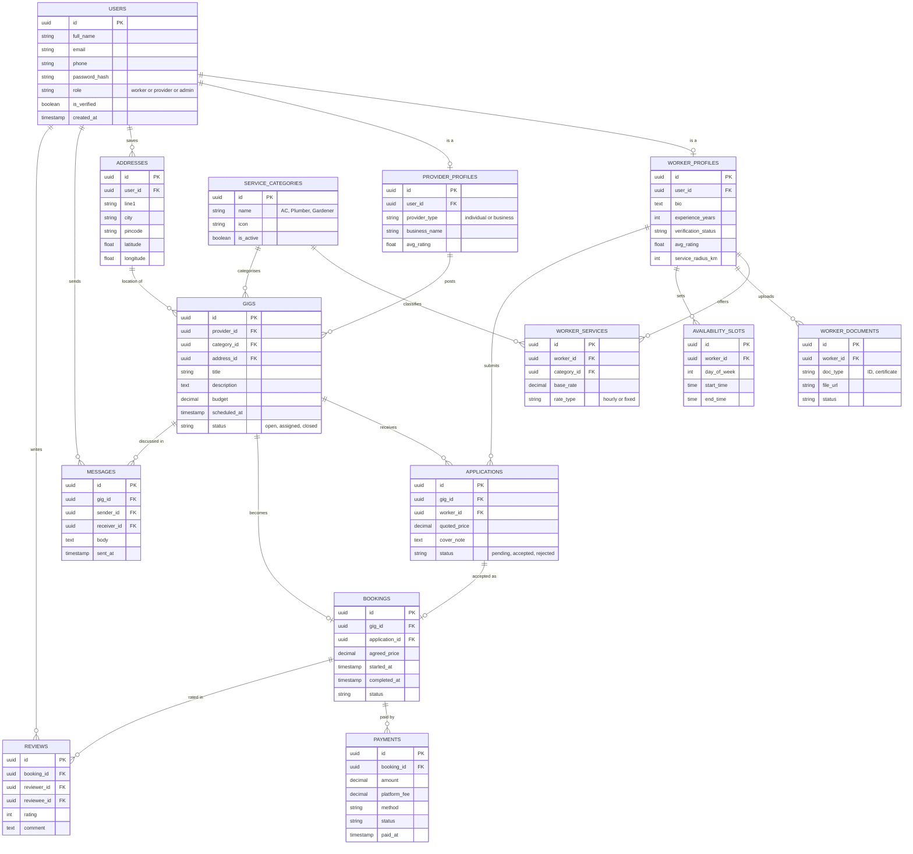

# Gig Worker Platform: Entity Relationship Diagram

A marketplace where **gig providers** (customers) post jobs and **workers** (AC technicians, gardeners, electricians, plumbers, etc.) apply for them, get booked, get paid and get reviewed.

---

## 1. ER diagram

The diagram uses [Mermaid](https://mermaid.js.org/) syntax. It renders automatically on GitHub, GitLab, Notion, Obsidian and VS Code (with a Mermaid preview extension).

---

## 2. Core flow

1. A **provider** posts a **Gig** with a category, address, budget and schedule.
2. Matching **workers** submit **Applications** with a quoted price.
3. The provider accepts one application, which creates a **Booking**.
4. The work is completed and a **Payment** is recorded.
5. Both sides leave a **Review**.

---

## 3. Entity overview

| Entity | Purpose |
|---|---|
| `USERS` | Login and identity for every person on the platform. `role` separates worker, provider and admin. |
| `WORKER_PROFILES` | Worker-specific details: bio, experience, rating, verification status, service radius. |
| `PROVIDER_PROFILES` | Provider-specific details: individual or business, business name, rating. |
| `ADDRESSES` | Saved addresses with coordinates, used for gig locations and distance-based search. |
| `SERVICE_CATEGORIES` | Master list of services (AC technician, plumber, electrician, gardener, ...). Admin-managed. |
| `WORKER_SERVICES` | Join table: which services a worker offers, with rate and rate type. |
| `WORKER_DOCUMENTS` | ID proofs and certificates uploaded for verification. |
| `AVAILABILITY_SLOTS` | Weekly working hours for each worker. |
| `GIGS` | A job posted by a provider. |
| `APPLICATIONS` | A worker's bid or quote on a gig. |
| `BOOKINGS` | The confirmed job, created when an application is accepted. |
| `PAYMENTS` | Money movement for a booking, including the platform fee. |
| `REVIEWS` | Two-way ratings. Both `reviewer_id` and `reviewee_id` point to `USERS`. |
| `MESSAGES` | Chat between provider and worker, scoped to a gig. |

---

## 4. Relationships

| From | To | Cardinality | Notes |
|---|---|---|---|
| `USERS` | `WORKER_PROFILES` | 1 : 0..1 | Only users with the worker role have one. |
| `USERS` | `PROVIDER_PROFILES` | 1 : 0..1 | Only users with the provider role have one. |
| `USERS` | `ADDRESSES` | 1 : many | A user can save several addresses. |
| `SERVICE_CATEGORIES` | `WORKER_SERVICES` | 1 : many | |
| `WORKER_PROFILES` | `WORKER_SERVICES` | 1 : many | A worker can offer several skills. |
| `WORKER_PROFILES` | `WORKER_DOCUMENTS` | 1 : many | |
| `WORKER_PROFILES` | `AVAILABILITY_SLOTS` | 1 : many | |
| `PROVIDER_PROFILES` | `GIGS` | 1 : many | |
| `SERVICE_CATEGORIES` | `GIGS` | 1 : many | |
| `ADDRESSES` | `GIGS` | 1 : many | Where the work happens. |
| `GIGS` | `APPLICATIONS` | 1 : many | |
| `WORKER_PROFILES` | `APPLICATIONS` | 1 : many | |
| `GIGS` | `BOOKINGS` | 1 : 0..1 | A gig has at most one confirmed booking. |
| `APPLICATIONS` | `BOOKINGS` | 1 : 0..1 | Only an accepted application becomes a booking. |
| `BOOKINGS` | `PAYMENTS` | 1 : many | Allows advance, final and refund entries. |
| `BOOKINGS` | `REVIEWS` | 1 : many | Up to two reviews, one per side. |
| `USERS` | `MESSAGES` | 1 : many | Both as sender and as receiver. |
| `GIGS` | `MESSAGES` | 1 : many | |

---

## 5. Suggested enums

| Field | Values |
|---|---|
| `USERS.role` | `worker`, `provider`, `admin` |
| `WORKER_PROFILES.verification_status` | `pending`, `verified`, `rejected` |
| `WORKER_SERVICES.rate_type` | `hourly`, `fixed` |
| `WORKER_DOCUMENTS.status` | `pending`, `approved`, `rejected` |
| `GIGS.status` | `open`, `assigned`, `in_progress`, `completed`, `cancelled` |
| `APPLICATIONS.status` | `pending`, `accepted`, `rejected`, `withdrawn` |
| `BOOKINGS.status` | `scheduled`, `in_progress`, `completed`, `cancelled` |
| `PAYMENTS.status` | `pending`, `paid`, `failed`, `refunded` |

---

## 6. Suggested constraints and indexes

- `USERS.email` and `USERS.phone`: unique.
- `WORKER_PROFILES.user_id` and `PROVIDER_PROFILES.user_id`: unique, so a user has one profile of each type.
- `WORKER_SERVICES (worker_id, category_id)`: unique.
- `APPLICATIONS (gig_id, worker_id)`: unique, so a worker applies once per gig.
- `BOOKINGS.gig_id`: unique, which enforces one booking per gig.
- `REVIEWS (booking_id, reviewer_id)`: unique, one review per side per booking.
- `REVIEWS.rating`: check constraint between 1 and 5.
- Indexes: `GIGS (category_id, status)`, `GIGS (scheduled_at)`, `ADDRESSES (latitude, longitude)`, `MESSAGES (gig_id, sent_at)`.

---

## 7. Not included yet

- Notifications table (push, SMS and email alerts).
- Disputes and refunds workflow.
- Direct hiring without a gig post. Make `BOOKINGS.gig_id` nullable or add a `DIRECT_REQUESTS` entity.
- Worker portfolio and photos.
- Coupons and promotions.
