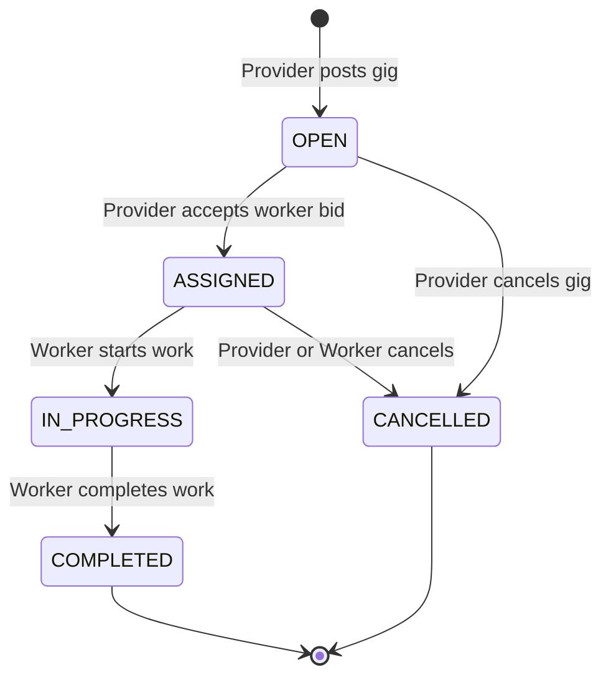
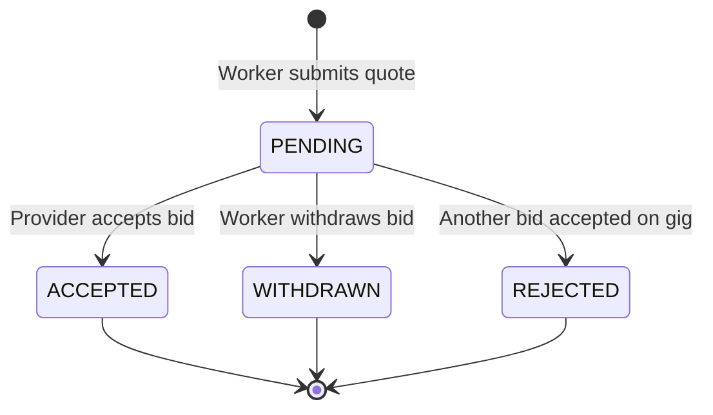
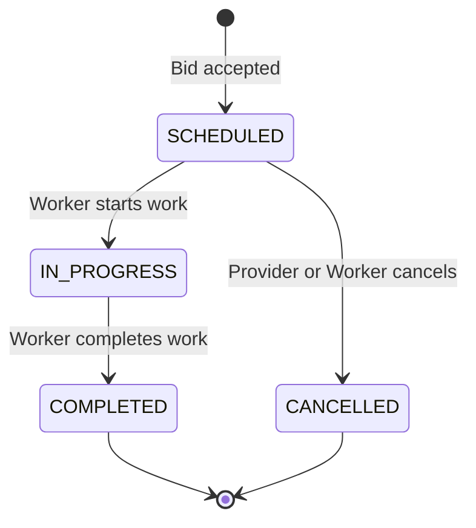

# GigMart Backend API Integration Specification

This reference document outlines the exact Spring Boot REST API contracts, request payloads, response schemas, and domain state machines consumed by the GigMart frontend.

---

## 1. Protocol & Response Envelope

* **Base URL in Production:** `http://localhost:8081/api/v1`
* **Vite Development Proxy:** Requests prefixed with `/api` forward automatically to port `8081`.
* **Standard Response Envelope:** All successful controller responses are wrapped in `ApiResponse<T>`:

```json
{
  "success": true,
  "message": "Success",
  "data": { ... } | [ ... ],
  "timestamp": "2026-11-08T09:00:00Z"
}
```

* **Error Response Envelope:** Validation errors return HTTP 400 or 409 with field error maps:
```json
{
  "success": false,
  "message": "Validation failed",
  "data": {
    "email": "Email address already exists",
    "budget": "Budget must be greater than zero"
  },
  "timestamp": "2026-11-08T09:00:00Z"
}
```

---

## 2. Endpoint Catalog by Domain

### 🔐 Authentication (`/api/v1/auth`)

| Method | Endpoint | Body | Description |
| :--- | :--- | :--- | :--- |
| `POST` | `/auth/register` | `{ fullName, email, phone, password, role }` | Role is `'WORKER'` or `'PROVIDER'` |
| `POST` | `/auth/login` | `{ email, password }` | Returns `UserResponse` (does not return profile ID) |

### 👤 Users (`/api/v1/users`)

| Method | Endpoint | Query / Body | Description |
| :--- | :--- | :--- | :--- |
| `GET` | `/users/{id}` | — | Get user details by UUID |
| `GET` | `/users` | `?role=WORKER` | Filter users by role |
| `PUT` | `/users/{id}/verify` | — | Admin verify user account |

### 🏷️ Categories (`/api/v1/categories`)

| Method | Endpoint | Query / Body | Description |
| :--- | :--- | :--- | :--- |
| `GET` | `/categories` | `?activeOnly=true` | List active or all categories |
| `GET` | `/categories/{id}` | — | Category details |
| `POST` | `/categories` | `{ name, icon, isActive }` | Create category |
| `PUT` | `/categories/{id}` | `{ name, icon, isActive }` | Update category |
| `DELETE`| `/categories/{id}` | — | Remove category |

### 🏢 Provider Profiles (`/api/v1/providers`)

| Method | Endpoint | Query / Body | Description |
| :--- | :--- | :--- | :--- |
| `GET` | `/providers/user/{userId}` | — | Retrieve provider profile by User UUID |
| `GET` | `/providers/{id}` | — | Retrieve provider profile by Profile UUID |
| `GET` | `/providers` | — | List all provider profiles |
| `PUT` | `/providers/{id}` | `{ providerType, businessName }` | Update provider business information |

### 👷 Worker Profiles & Sub-resources (`/api/v1/workers`)

| Method | Endpoint | Query / Body | Description |
| :--- | :--- | :--- | :--- |
| `GET` | `/workers/user/{userId}` | — | Retrieve worker profile by User UUID |
| `GET` | `/workers/{id}` | — | Retrieve worker profile by Profile UUID |
| `GET` | `/workers` | `?status=VERIFIED` | Filter workers by verification status |
| `PUT` | `/workers/{id}` | `{ bio, experienceYears, serviceRadiusKm, verificationStatus? }` | Update profile details |
| `POST` | `/workers/services` | `{ workerProfileId, categoryId, baseRate, rateType }` | Add offered service (`HOURLY` / `FIXED`) |
| `GET` | `/workers/{id}/services` | — | List worker services |
| `DELETE`| `/workers/services/{id}` | — | Remove worker service |
| `POST` | `/workers/slots` | `{ workerProfileId, dayOfWeek, startTime, endTime }` | Add slot (`dayOfWeek`: 1-7, time: `"HH:mm"`) |
| `GET` | `/workers/{id}/slots` | — | List availability slots |
| `DELETE`| `/workers/slots/{id}` | — | Remove slot |
| `POST` | `/workers/documents` | `{ workerProfileId, docType, fileUrl }` | Add document reference URL |
| `GET` | `/workers/{id}/documents` | — | List document records |

### 📍 Addresses (`/api/v1/addresses`)

| Method | Endpoint | Query / Body | Description |
| :--- | :--- | :--- | :--- |
| `POST` | `/addresses` | `{ userId, line1, city, pincode, latitude?, longitude? }` | Create service address |
| `GET` | `/addresses/{id}` | — | Get address details |
| `GET` | `/addresses/user/{userId}` | — | Get user's saved addresses |
| `DELETE`| `/addresses/{id}` | — | Delete saved address |

### 🛠️ Gigs (`/api/v1/gigs`)

| Method | Endpoint | Query / Body | Description |
| :--- | :--- | :--- | :--- |
| `GET` | `/gigs` | `?categoryId=&status=&keyword=` | Search and filter public gigs |
| `GET` | `/gigs/{id}` | — | Detailed gig view with applicant count |
| `GET` | `/gigs/provider/{providerProfileId}` | — | List provider's posted gigs |
| `POST` | `/gigs` | `{ providerProfileId, categoryId, addressId, title, description, budget, scheduledAt }` | Create gig (`scheduledAt`: `"YYYY-MM-DDTHH:mm:ss"`) |
| `POST` | `/gigs/{id}/cancel` | — | Cancel open or assigned gig |

### 📝 Applications & Quotes (`/api/v1/applications`)

| Method | Endpoint | Query / Body | Description |
| :--- | :--- | :--- | :--- |
| `POST` | `/applications` | `{ gigId, workerProfileId, quotedPrice, coverNote }` | Worker submits quote for a gig |
| `GET` | `/applications/{id}` | — | Get quote details |
| `GET` | `/applications/gig/{gigId}` | — | List quotes for a specific gig (for Provider) |
| `GET` | `/applications/worker/{workerProfileId}` | — | List worker's submitted quotes |
| `POST` | `/applications/{id}/withdraw` | — | Worker withdraws pending quote |

### 📅 Bookings (`/api/v1/bookings`)

| Method | Endpoint | Query / Body | Description |
| :--- | :--- | :--- | :--- |
| `POST` | `/bookings/accept/{applicationId}` | — | Provider accepts bid; creates booking |
| `GET` | `/bookings/{id}` | — | Detailed booking with timeline |
| `GET` | `/bookings/provider/{providerProfileId}` | — | List provider bookings |
| `GET` | `/bookings/worker/{workerProfileId}` | — | List worker bookings |
| `PUT` | `/bookings/{id}/status` | `{ status }` | Update status (`IN_PROGRESS`, `COMPLETED`, `CANCELLED`) |

### 💳 Payments (`/api/v1/payments`)

| Method | Endpoint | Query / Body | Description |
| :--- | :--- | :--- | :--- |
| `POST` | `/payments` | `{ bookingId, amount, method }` | Method: `'CARD'`, `'UPI'`, `'BANK_TRANSFER'`, `'CASH'`, `'WALLET'`. Backend computes 10% platform fee. |
| `GET` | `/payments/{id}` | — | Get payment receipt |
| `GET` | `/payments/booking/{bookingId}` | — | Returns array of payments for booking |

### ⭐ Reviews (`/api/v1/reviews`)

| Method | Endpoint | Query / Body | Description |
| :--- | :--- | :--- | :--- |
| `POST` | `/reviews` | `{ bookingId, reviewerId, rating, comment }` | Rating: 1-5 integer. Each participant can review once. |
| `GET` | `/reviews/booking/{bookingId}` | — | List reviews for a booking |
| `GET` | `/reviews/user/{userId}` | — | List reviews received by a user |

### 💬 Messages (`/api/v1/messages`)

| Method | Endpoint | Query / Body | Description |
| :--- | :--- | :--- | :--- |
| `POST` | `/messages` | `{ gigId, senderId, receiverId, body }` | Send in-app message |
| `GET` | `/messages/gig/{gigId}` | — | List all messages in gig thread |

---

## 3. Domain State Machines

### Gig Lifecycle



### Application / Quote Lifecycle



### Booking Lifecycle



