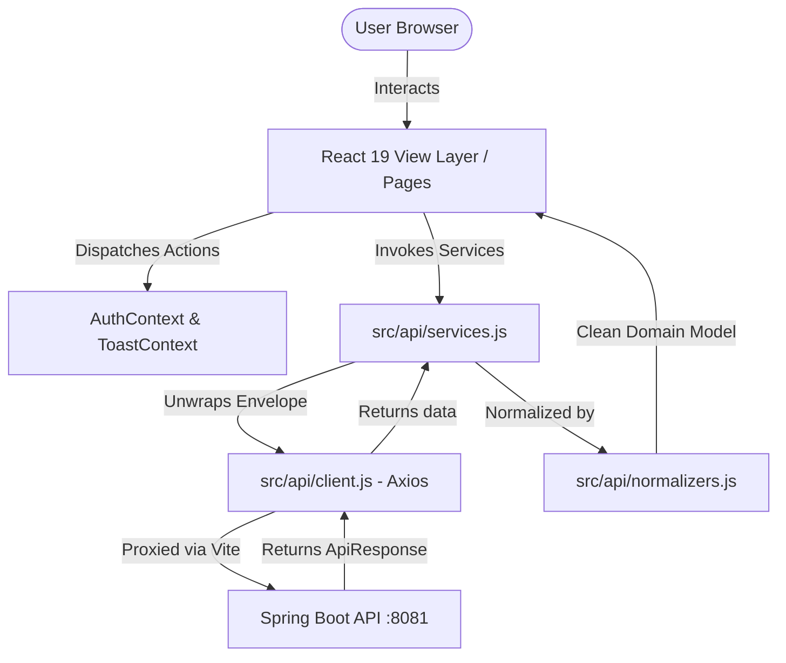
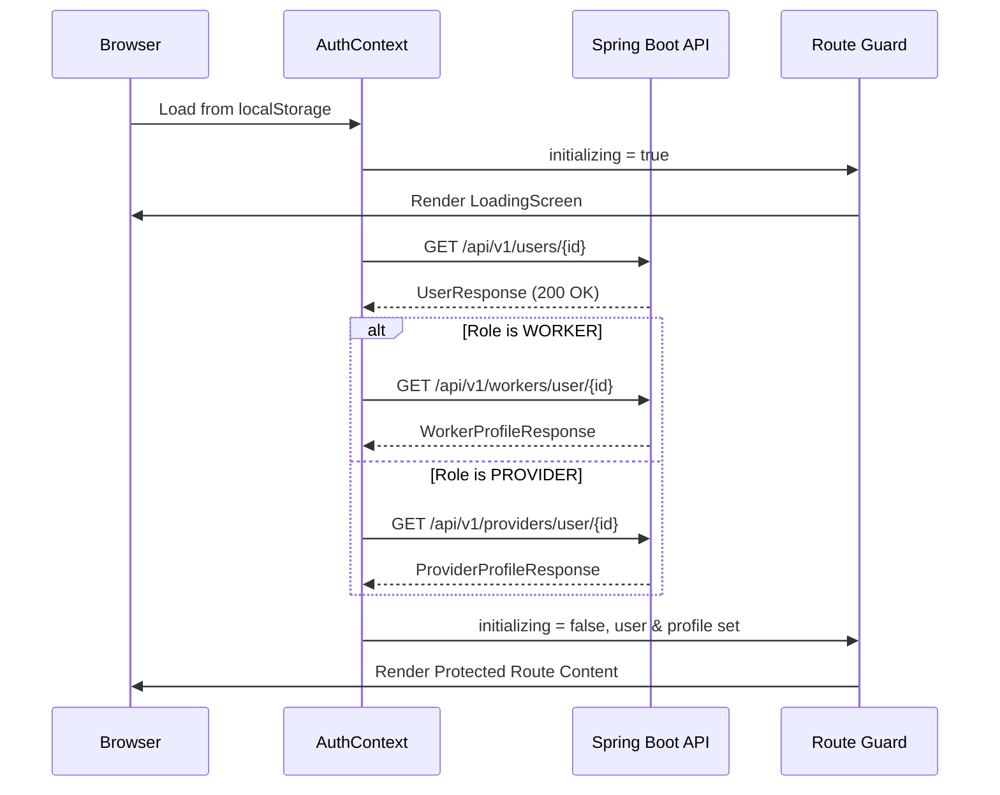

# GigMart Frontend Architecture Specification

This document provides a detailed overview of the architectural design, patterns, and component structures utilized throughout the GigMart React 19 frontend application.

---

## 1. High-Level System Architecture

The application adopts a modular, service-driven Single Page Application (SPA) architecture without bulky third-party state managers (such as Redux or Zustand). Instead, it uses standard React 19 hooks (`useContext`, `useCallback`, `useTransition`, `useEffect`), encapsulated API services, and typed normalizers.



---

## 2. Layered Responsibilities

| Layer | Files | Responsibility |
| :--- | :--- | :--- |
| **Routing & Guards** | `App.jsx`, `components/auth/Guards.jsx` | Route definition, role-based protection (`WORKER`, `PROVIDER`, `ADMIN`), and redirect handling. |
| **Contexts / Global State** | `context/AuthContext.jsx`, `context/ToastContext.jsx` | Authentication persistence, profile resolution, and non-blocking toast notifications. |
| **Pages** | `pages/*` | Domain views, data fetching effects, form states, and lifecycle actions. |
| **Reusable UI Components** | `components/ui/*`, `components/gig/*`, `components/layout/*` | Accessible, styled dumb/controlled primitives with stable element IDs. |
| **API Client & Services** | `api/client.js`, `api/services.js` | Axios interceptors, envelope unwrapping, clean query param generation, and HTTP calls. |
| **Data Normalizers** | `api/normalizers.js` | Bridges backend DTO differences into clean, predictable entity shapes for components. |
| **Formatting Helpers** | `lib/format.js` | Currency (`en-IN` INR), date, datetime formatting, and backend datetime transformation. |

---

## 3. State Management & Authentication Flow

### Session Initialization (`AuthContext.jsx`)
1. **Synchronous Boot:** Reads `localStorage['gigmart_user']` on the first render to avoid unauthenticated render blinks.
2. **Server-Side Validation:** Immediately triggers `userApi.getById(user.id)`.
   * **If HTTP 404:** The database may have been reseeded or the user removed. The session is cleared and state reset.
   * **If Network Error:** The cached session is preserved, and a toast notifies the user of offline status.
3. **Profile Resolution:** If valid, the profile is loaded according to role:
   * `WORKER` &rarr; `workerApi.getByUserId(user.id)`
   * `PROVIDER` &rarr; `providerApi.getByUserId(user.id)`
   * `ADMIN` &rarr; No profile required.
4. **Initialization Gate (`initializing` flag):** While `initializing === true`, route guards display a full-screen `LoadingScreen`, completely eliminating flash redirects during page reload.



---

## 4. API & Data Normalization Architecture

### The Anti-Leak Principle
Components never directly import Axios, never inspect HTTP headers, and never parse nested `.data.data` responses:
* `src/api/client.js` extracts `res.data` from the Spring Boot envelope `{ success, message, data, timestamp }`.
* `src/api/services.js` unwraps the payload via `const u = (p) => p.then(env => env.data);` and provides `toList(v)` which safely flattens array or paged responses.
* `src/api/normalizers.js` transforms raw payloads into strict schemas:

```javascript
// Example: Gig Normalizer
export function normalizeGig(raw) {
  if (!raw) return null;
  return {
    id: raw.id,
    providerProfileId: raw.providerProfileId ?? raw.providerId ?? raw.provider?.id,
    providerName: raw.providerName ?? raw.provider?.name ?? '',
    categoryId: raw.categoryId ?? raw.category?.id,
    categoryName: raw.categoryName ?? raw.category?.name ?? '',
    addressId: raw.addressId ?? raw.address?.id,
    addressSummary: raw.addressSummary ?? (raw.address ? `${raw.address.line1}, ${raw.address.city}` : ''),
    title: raw.title ?? '',
    description: raw.description ?? '',
    budget: Number(raw.budget ?? 0),
    scheduledAt: raw.scheduledAt ?? '',
    status: raw.status ?? 'OPEN',
    applicationCount: Number(raw.applicationCount ?? 0),
  };
}
```

---

## 5. Polling & Real-time Messaging Strategy

The in-app chat at `/messages` balances responsiveness with server resource economy without requiring WebSockets:
1. **Visibility Gating:** Polling runs on a `5000ms` timer using `setInterval`, but only executes when `document.visibilityState === 'visible'`.
2. **In-Flight Guard:** A local `inFlightRef` ensures that if a previous polling request is still processing, new network requests are dropped.
3. **Optimistic Append:** Sent messages immediately render in the thread with a temporary ID. If the server call fails, the message is reverted, re-populating the input box with an error toast.
4. **Smart Auto-Scroll:** When new messages arrive, the viewport scrolls to the bottom only if the user is already within 120px of the container's bottom edge, preventing annoying scroll jumps when reading older messages.
5. **Strict Cleanup:** Polling intervals and event listeners are cleared whenever the selected conversation changes or the component unmounts.

---

## 6. Design System & Styling Architecture

* **Engine:** Tailwind CSS v4 (`@tailwindcss/vite`). No PostCSS or legacy `tailwind.config.js`.
* **Palette:** Monochrome minimalist aesthetic based on dark neutrals (`#0a0a0a`), clean white card elevations (`#ffffff`), and subtle slate borders (`#e5e5e5`).
* **Background Texture:** A subtle fixed fractal noise SVG overlay on `body::before` at 2.5% opacity provides depth.
* **Reusable Class Tokens (`@layer components`):**
  * `.card`: Floating card with soft shadow, border, and `-translate-y-0.5` hover lift.
  * `.card-static`: Stationary bordered container for dashboards and detailed panels.
  * `.btn`: Standard interactive button with active scale transition (`active:scale-[0.98]`).
  * `.btn-primary`, `.btn-secondary`, `.btn-danger`, `.btn-ghost`: Standard semantic variants.
  * `.badge`: Pill badge with pastel background and semantic status dot.
* **Accessibility:** Full `prefers-reduced-motion` override that eliminates transitions and animations for users requesting reduced motion.

